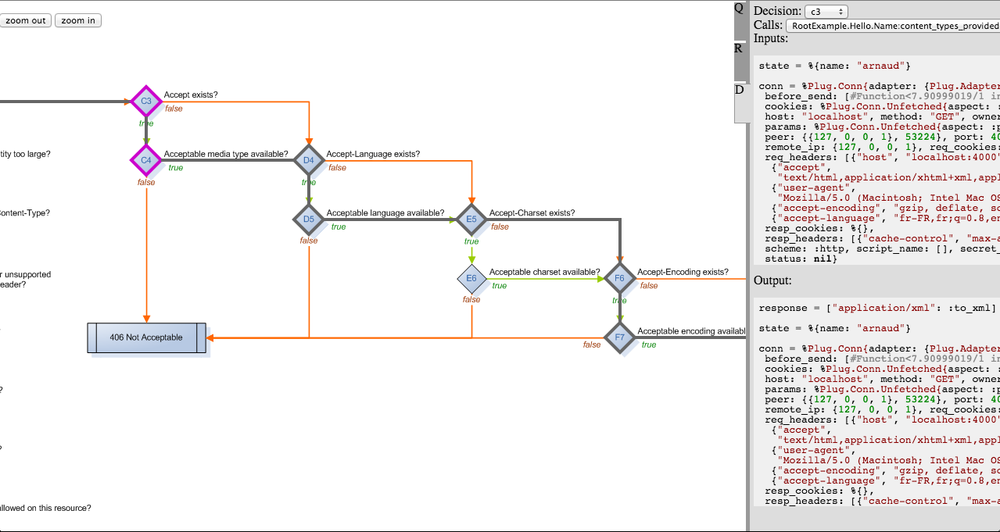

# Ewebmachine [](https://github.com/kbrw/ewebmachine/actions/workflows/build-and-test.yml) [](https://hex.pm/packages/ewebmachine) [](https://hexdocs.pm/ewebmachine) 

Ewebmachine is a full rewrite with clean DSL and plug integration
based on [Webmachine from basho](https://github.com/webmachine/webmachine). 

[Documentation for Ewebmachine is available on
hexdocs](https://hexdocs.pm/ewebmachine/readme.html).

## Installation

```elixir
    def deps do
      [
        {:ewebmachine, "~> 2.3"}
      ]
    end
```

> [!WARNING]
> This version is not backward compatible with the previous one that was only a
> thin wrapper around webmachine, use the branch 1.0-legacy to use the old one.

## Overview

Ewebmachine is an application layer that adds HTTP semantic awareness on top of
the excellent `Plug` library. Ewebmachine's DSL provides an easy way to work
with your application's data.

## Core concepts

Ewebmachine comes with a few core concepts:
* **Resource** (a.k.a. any information that can be named): is declared via the
  `Ewebmachine.Builder.Resources.resource/2` macro which expands into a plug
  module inside of which handlers are declared.

* **Handler**: an handler is a function which return value is used by the
  decision tree. Each handler has its own purpose and helps you make the
  appropriate response.

* **(HTTP) Decision tree**: process an HTTP connection by routing it through the
  decision tree where decisions are taken based on a resource's handlers. Its
  processing flow is described on [this schema](./assets/http_diagram.png)[^1].

With the core concepts in mind let's go through a simple example:
```elixir
defmodule App.Api do
  use Ewebmachine.Builder.Resources

  plug :resource_match
  plug Ewebmachine.Plug.Run
  plug Ewebmachine.Plug.Send

  resource "/api/users/:id" do
    %{user_id: id}
  after
    plug App.Api.CommonHandlers

    allowed_methods do: ["GET"]

    resource_exists do
      case App.User.fetch(state.user_id) do
        {:ok, user} -> pass(true, json_obj: user)
        {:error, :not_found} -> false
      end
    end

    defh to_json, do: JSON.encode!(state.user)
  end

  resource "/api/orders/:id" do
    %{order_id: id}
  after
    plug App.Api.CommonHandlers

    allowed_methods do: ["GET"]

    resource_exists do
      case App.Order.fetch(state.order_id) do
        {:ok, order} -> pass(true, json_obj: order)
        {:error, :not_found} -> false
      end
    end
  end
end

defmodule App.Api.CommonHandlers do
  use Ewebmachine.Builder.Handlers

  plug :add_handlers, init: %{}

  content_types_provided do: ["application/json": :to_json]

  defh to_json, do: JSON.encode!(state.json_obj)
end
```

Let's go through this example by calling the `App.Api` plug module with a fake
connection:
```elixir
conn = Plug.Test.conn("GET", "/api/users/1")
conn = App.Api.call(conn, [])
```

The `App.Api` module is a `Plug.Router` composed of the routes `/api/users/:id`
and `/api/orders/:id` which are defined via the `resource` macro. When our
connection enter this plug pipeline it first goes through the `:resource_match`
plug which calls the plugs `:match` and `:dispatch` defined by `Plug.Router`.
The `/api/users/:id` path being matched, the connection is dispatched to this
`resource`.

*The resource macro underneath makes a plug module into which the
`:add_handlers` plug is added*.

The connection goes through the resource's plug module which contains the
`App.Api.CommonHandlers` and `:add_handlers` plug.

*The `:add_handlers` function plug sets inside the connection the module
implementing each handler. In this example the `allowed_methods` and
`resource_exists` handlers will be those of the resource module whereas the
module used for the definition of the `content_types_provided` handler will be
`App.Api.CommonHandlers`.*

The connection continues through the plug pipeline and then enters the
`Ewebmachine.Plug.Run` plug which executes the decision tree with the set
handlers. The response is then sent by the `Ewebmachine.Plug.Send` plug.

## Use Cowboy to serve the plug

Given that module using the `Ewebmachine.Builder.Resources` becomes a plug, they
can be exposed, for instance via the Cowboy server:

```elixir
defmodule MyApp do
  use Application

  def start(_type, _args) do
    children = [Plug.Cowboy.child_spec(:http, App.Api, [], port: 80)]

    Supervisor.start_link(children, strategy: :one_for_one)
  end
end
```

## Debug UI 

By adding the `Ewebmachine.Plug.Debug` plug to the plug pipeline of your
application you can have access to a debug UI exposed on the `/wm_debug` route.



# CONTRIBUTING

Hi, and thank you for wanting to contribute.
Please refer to the centralized informations available at: https://github.com/kbrw#contributing

[^1]: All credits for this schema goes to Alan Dean and Justin Sheehy. See
    [here](https://github.com/webmachine/webmachine/wiki/Diagram).
